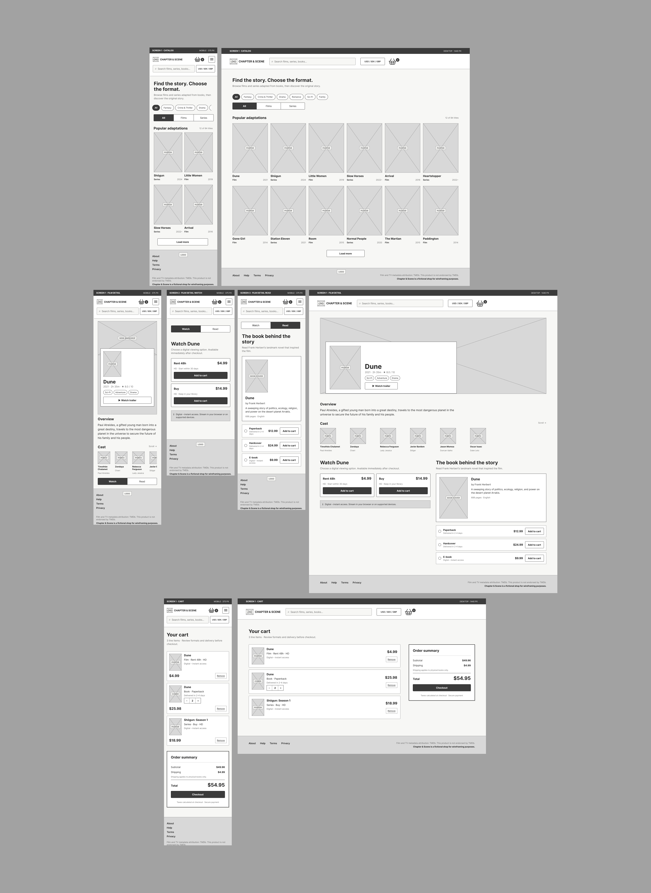
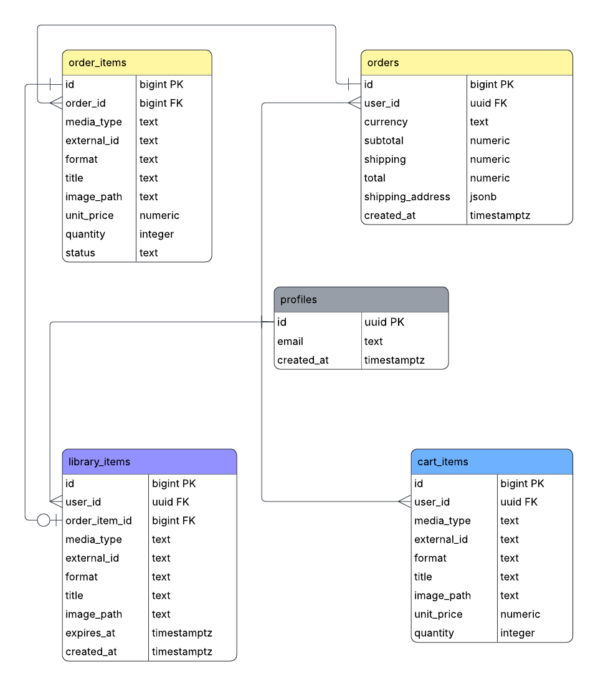
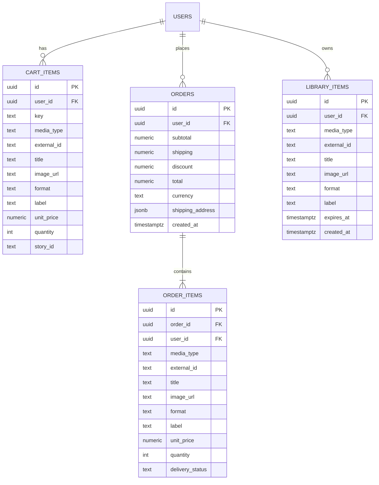

# Chapter & Scene

[LIVE SITE](https://chapter-and-scene.vercel.app)

Chapter & Scene is a shop for stories that exist both as a book and on screen. Every film and series in the shop is based on a book, so users can watch the adaptation, read the book it came from, or get both together at a lower price.

Films and series can be rented or bought, and books come as paperback, hardcover or e-book. Everything a user buys or rents ends up in their own library, where a trailer stands in for the film and e-books open in a Google Books preview.

Titles come from TMDb, books from Google Books and exchange rates from Frankfurter. Accounts, carts, orders and libraries are stored in Supabase. The app is built with React, Redux Toolkit and RTK Query.

## Table of Contents

- [UX](#ux)
  - [Site Purpose](#site-purpose)
  - [Site Goals](#site-goals)
  - [Audience](#audience)
  - [Communication](#communication)
  - [User Goals](#user-goals)
- [Agile Workflow](#agile-workflow)
  - [User Stories](#user-stories)
  - [MoSCoW Prioritisation](#moscow-prioritisation)
  - [Milestones](#milestones)
  - [Kanban Board](#kanban-board)
- [Design](#design)
  - [Wireframes](#wireframes)
  - [Database Schema](#database-schema)
  - [Colour Scheme](#colour-scheme)
  - [Typography](#typography)
  - [Logo](#logo)
- [Features](#features)
- [Data and APIs](#data-and-apis)
- [Testing](#testing)
  - [Manual Testing](#manual-testing)
  - [Lighthouse](#lighthouse)
  - [Bugs](#bugs)
- [Known Limitations](#known-limitations)
- [Future Improvements](#future-improvements)
- [Technologies Used](#technologies-used)
- [Project Structure](#project-structure)
- [Deployment](#deployment)
  - [Deploying with Vercel](#deploying-with-vercel)
  - [Running the Project Locally](#running-the-project-locally)
- [Credits](#credits)

## UX

### Site Purpose

Many films and series are based on books, but the book and the adaptation are usually sold in different places. Chapter & Scene brings them together, so a user can find a story once and choose how to experience it: watch it, read it, or both.

### Site Goals

- Only show films and series that are based on a book.
- Show every way to get a story on one page, with clear prices for each format.
- Make buying simple, with a cart that works without an account and follows the user when they log in.
- Give users a library where they can use what they have bought or rented.

### Audience

- Readers who want to see the film or series of a book they love.
- Viewers who want to read the book behind something they have watched.
- People who enjoy having a story in more than one format.

### Communication

The design is dark and cinematic, inspired by streaming services, so the posters and backdrops are in focus. A carousel and themed rows on the home page invite the user to explore, and the header gives quick access to films, series, search and the cart on every page.

On a title's page, tabs separate the ways to get the story: watch it, read the book, or get both as a bundle. Prices are always in US dollars, with a conversion to the chosen currency next to them.

### User Goals

As a visitor, I want to:

- Browse films and series based on books, and filter them by category.
- Search for a title.
- See details about a film or series, and the book it is based on.
- Add films, series and books to my cart without an account.
- See prices in my own currency.

As a logged-in user, I also want to:

- Check out and see an order confirmation.
- See my order history and follow the delivery of physical books.
- Watch and read what I have bought or rented in my library.
- See how much time is left on a rental, and rent or buy a title again when it has expired.

[Back to top](#table-of-contents)

## Agile Workflow

The project was planned with user stories, written as GitHub issues in the format *"As a [user] I can [action], so I can [goal]"*. Each user story has acceptance criteria and tasks, and an ID from CS-001 to CS-048 that is also used in branch names and commit messages, for example `feature/CS-028-order-history`. Every change was made on its own branch and merged with a pull request.

All issues can be found [HERE](https://github.com/Linnea87/chapter-and-scene/issues?q=is%3Aissue).

### User Stories

The user stories are grouped into seven EPICs. All *Must Have*, *Should Have* and *Could Have* user stories are implemented, and the two *Won't Have* stories were left out on purpose.

#### Implemented User Stories

<strong>EPIC 1 - Catalog & search</strong>

 

- **CS-001** As a Visitor I can explore movies and series based on books, so I can discover stories I might want to read or watch.

- **CS-002** As a Visitor I can filter the catalog by category, so I can find stories in genres I like.

- **CS-003** As a Visitor I can search for a title, so I can quickly find a specific story.

- **CS-004** As a Visitor I can see that content is loading, so I can tell that the app is working.

- **CS-005** As a Visitor I can see a clear message when something goes wrong, so I can understand what happened and try again.

- **CS-006** As a Visitor I can choose to see movies, series or both, so I can find the format I am in the mood for.

- **CS-007** As a Visitor I can see a message when my search or filter has no results, so I can tell that the app is not broken.

- **CS-008** As a Visitor I can load more titles, so I can keep browsing beyond the first page.

- **CS-045** As a Visitor I can discover featured stories and themed rows on the home page, so I can find something to read or watch without searching.

- **CS-046** As a Visitor I can search for any movie or series title, so I can find out if it is based on a book, even if it is not shown in the catalog yet.

 

<strong>EPIC 2 - Title details</strong>

 

- **CS-010** As a Visitor I can see detailed information about a movie, so I can decide whether I want to watch it.

- **CS-011** As a Visitor I can see details about a series and its seasons, so I can choose what to buy.

- **CS-012** As a Visitor I can see the book a movie or series is based on, so I can choose to read the book, watch the adaptation or both.

- **CS-013** As a Visitor I can watch the trailer, so I can get a feel for the movie or series before buying.

- **CS-014** As a Visitor I can see a clear message when a title does not exist, so I can find my way back.

- **CS-015** As a Visitor I can see the other movies in the same movie series, so I can follow the whole story.

- **CS-047** As a Visitor I can switch between watching and reading options with tabs, so I can focus on one format at a time without a long page.

 

<strong>EPIC 3 - Cart</strong>

 

- **CS-016** As a Visitor I can add a movie, series or book to my cart in the format I choose, so I can buy it later.

- **CS-017** As a Visitor I can remove items from my cart, so I can only buy what I want.

- **CS-018** As a Visitor I can see how many items are in my cart, so I can always know what I have selected.

- **CS-019** As a Visitor I can keep my cart when I reload the page, so I can continue where I left off.

- **CS-020** As a Visitor I can change the quantity of physical books, so I can buy more than one copy.

- **CS-021** As a Visitor I can see subtotal, shipping and total, so I can know what I will pay.

- **CS-022** As a Visitor I can get a discount when I buy both the book and the movie or series, so I can get more for my money.

- **CS-044** As a Visitor I can choose to see prices in USD, SEK or GBP, so I can understand the prices in a currency I know.

 

<strong>EPIC 4 - Account</strong>

 

- **CS-023** As a Visitor I can create an account, log in and log out, so I can keep my purchases and library.

- **CS-024** As a Visitor I can keep my cart when I log in, so I can avoid adding everything again.

 

<strong>EPIC 5 - Checkout & orders</strong>

 

- **CS-026** As a User I can complete my purchase, so I can get access to what I bought.

- **CS-027** As a User I can see a confirmation after my purchase, so I can know that it went through.

- **CS-028** As a User I can see my previous orders, so I can keep track of what I have bought.

- **CS-029** As a User I can see the delivery status of my physical books, so I can know when they will arrive.

 

<strong>EPIC 6 - My library</strong>

 

- **CS-030** As a User I can see everything I have bought or rented digitally, so I can access it in one place.

- **CS-031** As a User I can see how long I have left on a rental, so I can watch it in time.

- **CS-032** As a User I can play a movie or series from my library, so I can watch what I have bought.

- **CS-033** As a User I can open an e-book from my library, so I can read what I have bought.

- **CS-034** As a User I can see when I already own a title, so I can avoid buying it twice.

- **CS-035** As a User I can find my expired rentals in one place, so I can easily buy or rent the movie again.

 

<strong>EPIC 7 - Setup & delivery</strong>

 

- **CS-036** As a Developer I can start from the Twinflower base structure, so I can spend my time on the new features.

- **CS-037** As a Developer I can manage the cart with Redux Toolkit, so I can share cart state across the whole app.

- **CS-038** As a Developer I can fetch data from TMDb through one service, so I can keep API logic out of the components.

- **CS-039** As a Developer I can fetch book data from Google Books through one service, so I can combine it with TMDb data.

- **CS-040** As a Developer I can store orders, cart and library in Supabase, so I can keep user data safe and available across devices.

- **CS-041** As a Developer I can credit the APIs I use, so I can follow their terms of use.

- **CS-042** As a Developer I can document the project, so I can show how it is built and how it works.

- **CS-043** As a Developer I can deploy the app, so I can share it through a link.

- **CS-048** As a Visitor I can browse a shop with a clear and inviting look, so I can enjoy finding stories to watch and read.

#### Not Implemented User Stories

<strong>EPIC 1 - Catalog & search</strong>

 

- **CS-009** As a Visitor I can sort the catalog, so I can see the most popular, newest or highest rated stories first. *The home page rows already show the newest, most popular and highest rated stories, each with a "See all" page, so a separate sort control was not needed.*

 

<strong>EPIC 4 - Account</strong>

 

- **CS-025** As a User I can reset my password, so I can get back into my account if I forget it. *Resetting a password needs emails to be sent, and Supabase's free email service only sends to the project's own team members.*

### MoSCoW Prioritisation

Each user story was labelled *Must Have*, *Should Have*, *Could Have* or *Won't Have*, so the most important features were built first.

| Priority | User stories |
| --- | --- |
| Must Have | 18 |
| Should Have | 15 |
| Could Have | 5 |
| Won't Have | 2 |

### Milestones

The work was planned in two milestones: **Week 1: Requirements**, with the catalog, title details and cart, and **Week 2: Accounts & library**, with accounts, checkout, orders and the library.

The milestones can be found [HERE](https://github.com/Linnea87/chapter-and-scene/milestones?state=closed).

### Kanban Board

A GitHub Projects board was used to follow each issue from backlog to done. It can be found [HERE](https://github.com/users/Linnea87/projects/18/views/1).

[Back to top](#table-of-contents)

## Design

### Wireframes

Low-fidelity wireframes were made for the three main pages, the catalog, the title details and the cart, on mobile (375 px) and desktop (1440 px). They set the structure of the shop: the filters above the grid, the watch and read options on the title page, and the order summary next to the cart.

The final design changed in places as the project grew:

- The catalog became a home page with a carousel and themed rows, and separate Movies and Series pages replaced the Films/Series toggle.
- The header became a row of icons with the logo, and the search bar opens from a search icon.
- The Watch and Read options on the title page became tabs, with a third tab for the book and film bundle.

The final pages are shown under [Features](#features).

<strong>Wireframes</strong>

### Database Schema

Supabase stores everything that belongs to a user. Each table is linked to the user's account, and Row Level Security makes sure that users can only read and change their own rows. Titles and books are not stored, they are fetched from TMDb and Google Books with the `external_id`.

The plan changed during the project. Supabase's own `auth.users` table is used for accounts, so the planned `profiles` table was not needed, and new columns were added as features grew, for example `discount` on orders and `story_id` on cart items.

- **cart_items:** the cart of a logged-in user, so it is kept across devices. `key` makes each title and format unique in the cart, and `story_id` links a book to its film or series for the bundle discount.
- **orders:** one row per purchase, with the prices in US dollars and the shipping address for physical books.
- **order_items:** the titles in each order. `delivery_status` shows if a physical book is processing or shipped.
- **library_items:** everything a user has bought or rented digitally. `expires_at` is set for rentals and empty for titles that are bought.

The full schema with all policies is in [`supabase/schema.sql`](supabase/schema.sql).

<strong>The first plan of the database</strong>

 

<strong>The final database</strong>

### Colour Scheme

A dark theme lets the posters and backdrops stand out, like on a streaming service. Turquoise was chosen as the brand colour, as it is easy to read on the dark background and less common than the purple and red many streaming sites use.

| Colour | Hex | Used for |
| --- | --- | --- |
| Background | `#0B1517` | The page |
| Surface | `#132326` | Cards, menus and the footer |
| Text | `#EEF6F6` | Headings and body text |
| Muted text | `#9DB3B5` | Secondary text |
| Turquoise | `#22C4C4` | The current page icon, badges and focus rings |
| Aqua | `#7CEFE6` | The end of the button gradient and success messages |

Buttons use a gradient from turquoise to aqua with dark text, which is easier to read than white text on turquoise. A soft turquoise glow at the top of every page ties the pages together.

### Typography

- **Headings:** Georgia, a serif that gives a bookish feel and matches the serif in the logo.
- **Body text:** the system font of the device (`system-ui`), which is easy to read and loads instantly.

### Logo

The logo is a film strip that rises out of an open book and forms an S, so the story goes from the page to the screen. The icon is used on its own in the header, as the favicon and as the app icon, and the full logo with the name is shown in the footer.

[Back to top](#table-of-contents)